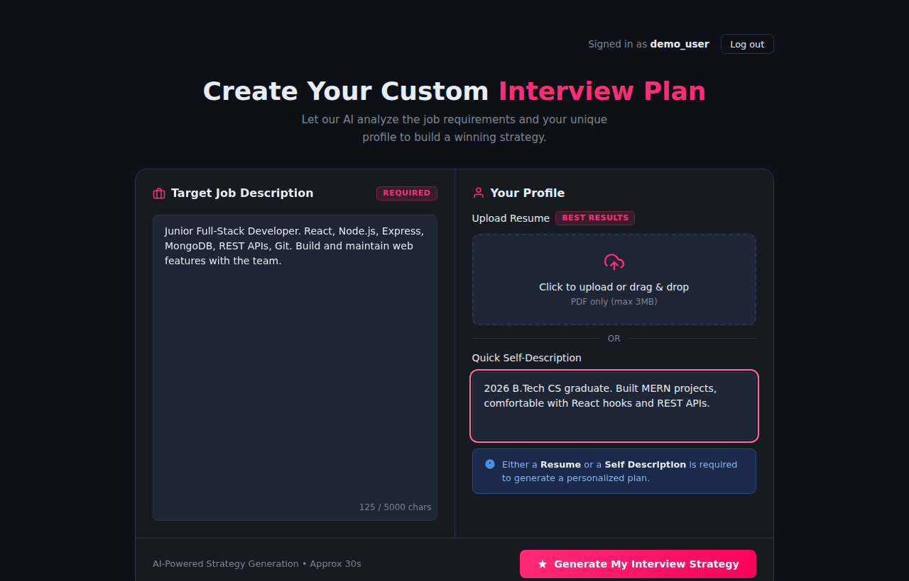
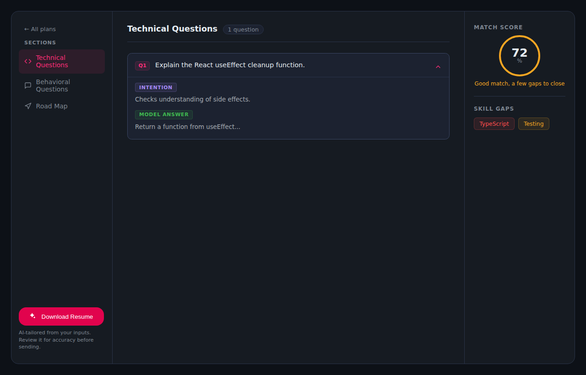
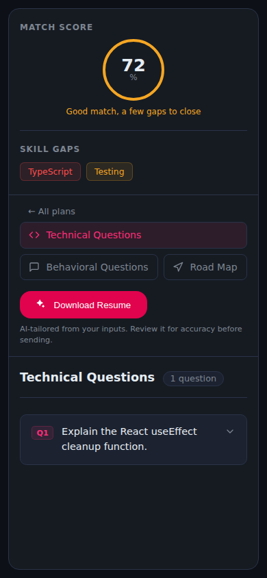
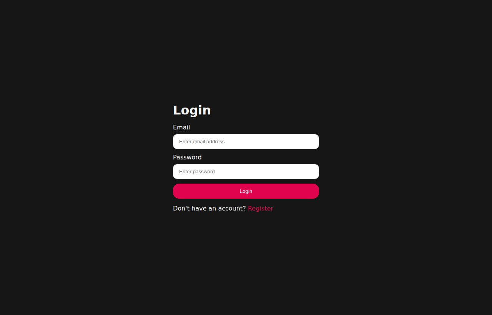

# AI Interview Prep Planner

A full-stack web app that turns a **job description** and your **resume** into a personalised interview-prep plan: a match score, likely technical and behavioural questions with answer guidance, a skill-gap analysis, and a day-by-day preparation roadmap. It can also generate a tailored resume PDF.

> **Live demo:** _add your deployed link here after deploying_

<p>
  
  
</p>
<p>
  
  
</p>

_Screenshots show sample data from a test run with the AI service stubbed out._

## Features

- Register / log in with email and password (JWT stored in an `httpOnly` cookie)
- Paste a job description, then upload a **PDF resume** (drag and drop supported) **or** write a short self-description
- AI-generated report: match score, technical questions, behavioural questions, skill gaps with severity, and a preparation plan
- Reports are saved per user; view or delete your previous plans
- Download an AI-tailored resume as a PDF (generated from your own resume data; always review it before sending)
- Loading, error, and empty states on every screen; responsive layout for phone, tablet, and desktop

## Tech stack

| Layer | Technology |
|---|---|
| Frontend | React 19, Vite, React Router 7, Axios, SCSS |
| Backend | Node.js, Express 5, Mongoose (MongoDB) |
| Auth | JWT in httpOnly cookie, bcryptjs, logout token blacklist (auto-expiring) |
| AI | Google Gemini (`@google/genai`), response validated with Zod |
| Files | multer (in-memory upload), pdf-parse (resume text), Puppeteer (HTML to PDF) |
| Tests | Node's built-in test runner (`node --test`) |

## How it works

```
Browser (React)                         Express API                         External
───────────────                         ───────────                         ────────
Home.jsx ── useInterview() ── axios ──► POST /api/interview
                                         ├─ authUser (JWT cookie check)
                                         ├─ rate limit, multer (PDF, max 3MB)
                                         ├─ validate input
                                         ├─ pdf-parse → resume text
                                         ├─ ai.service ─────────────────────► Gemini (JSON schema)
                                         │     └─ Zod validates the AI response
                                         └─ save report in MongoDB
Interview.jsx ◄── report JSON ◄──────────┘
```

**Frontend structure** (feature folders):

```
Frontend/src
├── api/client.js              one shared axios instance (base URL from env)
├── components/                LoadingScreen, NotFound
├── utils/getErrorMessage.js   turns API errors into readable text
└── features/
    ├── auth/                  AuthProvider (context), useAuth hook, Login, Register, route guards
    └── interview/             InterviewProvider (context), useInterview hook, Home, Interview pages
```

Data flow: **page → hook → API service → backend**. Pages never call axios directly; the hook updates shared state (Context) and converts failures into an `error` message.

## Getting started

**Requirements:** Node.js 20+, a MongoDB database (local or free [MongoDB Atlas](https://www.mongodb.com/atlas)), and a free [Gemini API key](https://aistudio.google.com/apikey).

```bash
# 1. Backend
cd Backend
cp .env.example .env      # then fill in the values
npm install
npm run dev               # http://localhost:3000

# 2. Frontend (new terminal)
cd Frontend
cp .env.example .env
npm install
npm run dev               # http://localhost:5173
```

### Environment variables

**Backend/.env**

| Variable | Required | Description |
|---|---|---|
| `MONGO_URI` | yes | MongoDB connection string |
| `JWT_SECRET` | yes | Long random string used to sign login tokens |
| `GOOGLE_GENAI_API_KEY` | yes | Gemini API key |
| `GEMINI_MODEL` | no | Model name (default `gemini-3-flash-preview`) |
| `PORT` | no | Default `3000` |
| `CLIENT_URL` | no | Allowed frontend origin for CORS (default `http://localhost:5173`) |
| `NODE_ENV` | no | `production` enables secure cookies |
| `TRUST_PROXY` | no | Set to `1` behind a proxy (Render, Railway) |
| `PUPPETEER_NO_SANDBOX` | no | Set to `1` only inside Docker/cloud containers that need it |

**Frontend/.env**

| Variable | Description |
|---|---|
| `VITE_API_URL` | Backend URL, e.g. `http://localhost:3000` |

The server refuses to start if a required backend variable is missing. **Never commit `.env`** (it is git-ignored).

## API

| Method | Route | Auth | Description |
|---|---|---|---|
| POST | `/api/auth/register` | – | Create account |
| POST | `/api/auth/login` | – | Log in |
| GET | `/api/auth/logout` | – | Log out (token is blacklisted) |
| GET | `/api/auth/get-me` | yes | Current user |
| POST | `/api/interview` | yes | Generate report (multipart: `jobDescription`, `selfDescription`, `resume` PDF) |
| GET | `/api/interview` | yes | List my reports |
| GET | `/api/interview/report/:id` | yes | Get one report (own reports only) |
| DELETE | `/api/interview/report/:id` | yes | Delete a report (own reports only) |
| POST | `/api/interview/resume/pdf/:id` | yes | Tailored resume PDF (own reports only) |
| GET | `/api/health` | – | Health check |

## Testing

```bash
cd Backend && npm test      # 25 tests
cd Frontend && npm run lint && npm run build
```

Backend tests run the real Express app with the database and AI service replaced by fakes, so they need no MongoDB or API key. They cover input validation, authentication, **per-user data ownership**, upload checks, and error handling.

## Security notes

- Passwords hashed with bcrypt; login errors never reveal whether an email exists
- JWT in an `httpOnly`, `sameSite` cookie (`secure` in production), not readable from JavaScript
- Every report read, delete, and PDF export is scoped to the logged-in user
- Inputs validated on the server (types, lengths, PDF signature check); non-string values rejected to prevent NoSQL injection
- Rate limiting on login and on the AI endpoints (the AI calls cost money)
- AI output is parsed and validated with Zod before use; generated resume HTML is rendered with JavaScript disabled
- Resume prompt instructs the model not to invent facts, but AI can still make mistakes: **review generated content**

## Known limitations

- Resume upload supports text-based PDFs only (no DOCX, no scanned images)
- Report generation takes about 30 seconds and shows a wait screen (no streaming)
- Puppeteer needs a Chrome install on the server; some free hosting tiers are too small for it
- No automated frontend tests yet

## Deployment (suggested)

MongoDB Atlas + backend on Render/Railway + frontend on Vercel/Netlify. In production set `NODE_ENV=production`, `TRUST_PROXY=1`, `CLIENT_URL=<your frontend URL>` on the backend and `VITE_API_URL=<your backend URL>` on the frontend. Because the frontend and backend are on different domains, the cookie uses `sameSite=none; secure`, which requires HTTPS on both.

## Credits

_Edit this section so it is accurate. For example: "Based on a YouTube tutorial by <creator> (link). I extended it with: ..." and list what you personally added._
